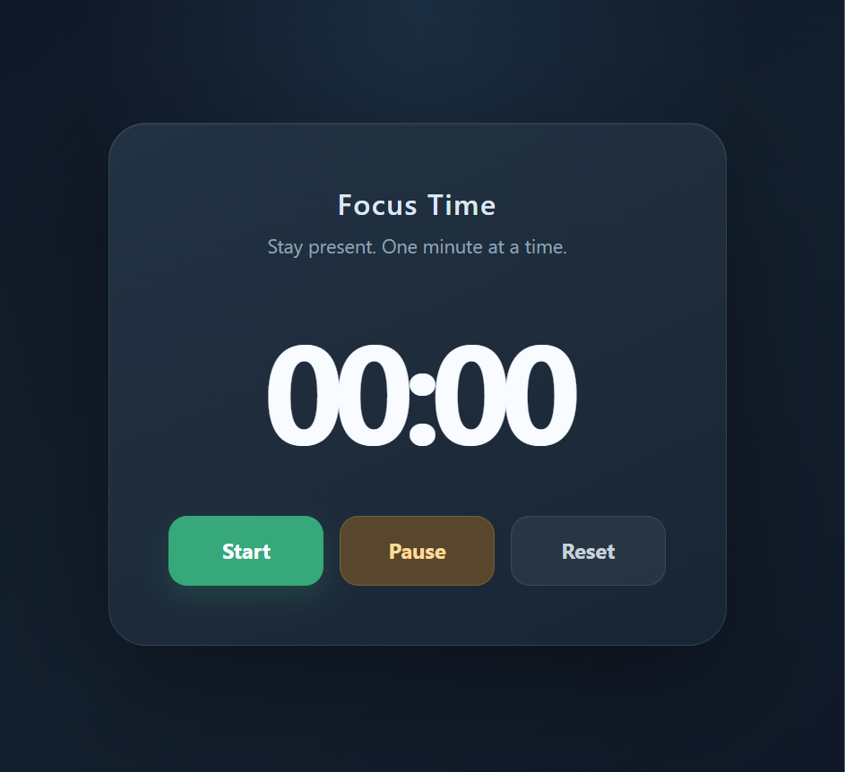

Focus Time ⏱️

Focus Time is a simple, mobile-friendly focus timer designed to help developers track their coding sessions and build consistent work habits.

The project was built as part of my 100 Projects Challenge, where I'm improving my frontend development skills by building practical projects.

✨ Features
▶️ Start a focus session.
⏸️ Pause and resume the timer.
🔄 Reset the timer.
💾 Save elapsed time using browser Local Storage.
🔁 Restore saved time after refreshing the page.
📱 Responsive, mobile-friendly interface.

Only list features you've implemented and tested successfully.

🛠️ Technologies
HTML5
CSS3
JavaScript
Browser Local Storage

🚀 Getting Started

1. Clone the repository
   git clone YOUR_GITHUB_REPOSITORY_URL

Replace YOUR_GITHUB_REPOSITORY_URL with your actual repository URL.

2. Open the project

Open the project folder in your code editor.

3. Run the application

Open index.html in your browser, or use the Live Server extension in VS Code.

🧠 What I Learned

While building Focus Time, I practiced:

Using Date.now() to calculate elapsed time.
Working with setInterval() and clearInterval().
Converting elapsed seconds into minutes and seconds.
Using Math.floor() and padStart() to format the timer.
Managing timer state when starting, pausing, and resuming.
Saving and retrieving data with Local Storage.
Debugging variable scope and timer calculations.
🔮 Future Improvements

Possible improvements include:

Configurable focus-session durations.
Daily focus statistics.
A history of completed sessions.
Notifications when a session finishes.
Persistent recovery of an active session after refreshing the page.

These are future ideas, not existing features.

👨‍💻 About This Project

Focus Time is Project 2 of my 100 Projects Challenge, documenting my journey toward becoming a better frontend developer.

I'm sharing my progress, lessons, and projects as I build practical applications and improve my development skills.
